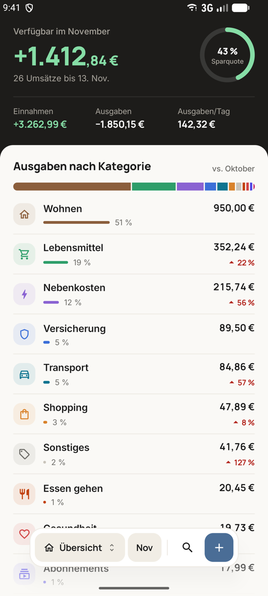
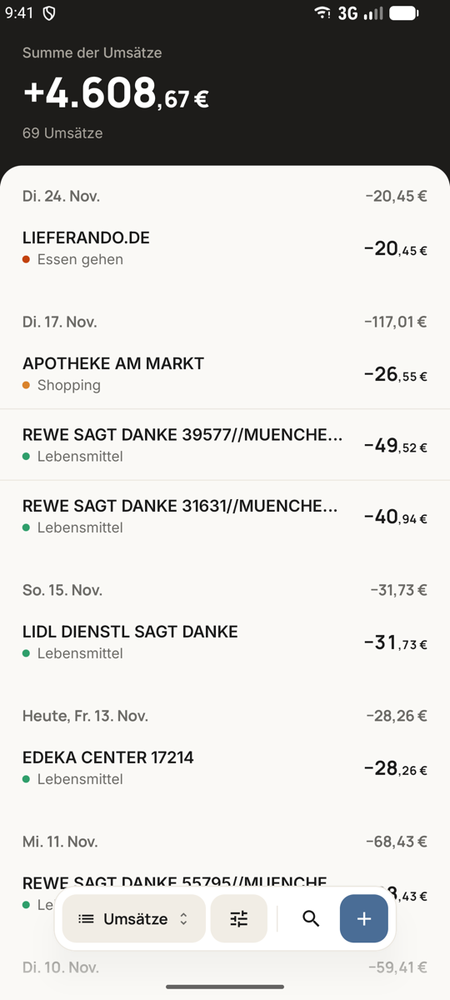
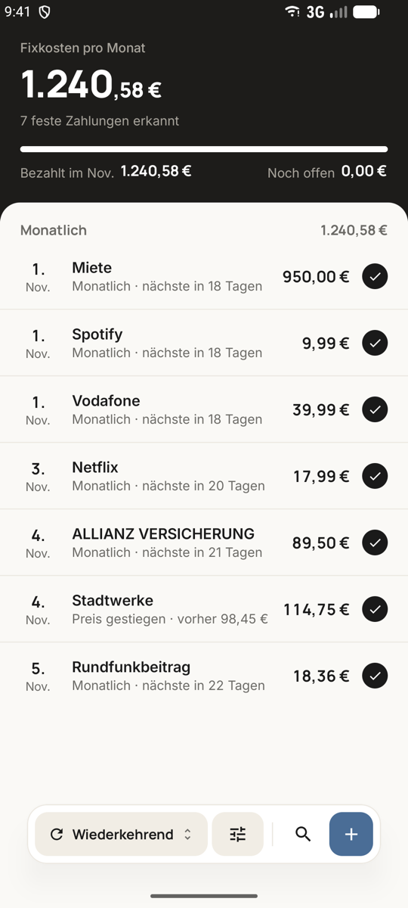
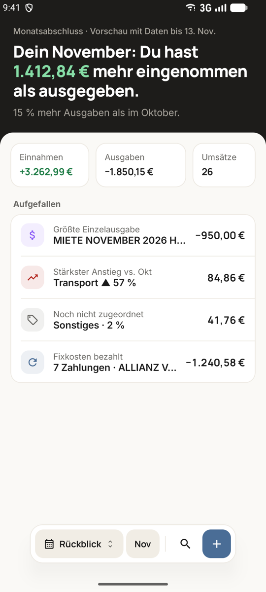

# wimg

**Wo ist mein Geld?** A local-first personal finance app. Your bank data stays on your phone.

<p>
  
  
  
  
</p>

<sub>Screenshots show the app's built-in demo data.</sub>

One Zig library, **libwimg** (with SQLite compiled in), is the whole app: CSV parsing,
bank protocol, categorisation, queries. The Android (Kotlin/Compose over JNI) and iOS
(SwiftUI over the C ABI) apps are thin shells that render what the library returns.

Website: https://wimg.komiljonmaksudov.com

## What it does

- **Bank access via FinTS**, straight from the phone to your bank. No aggregator in between.
  PIN/TAN, photoTAN and app approval (decoupled TAN), MT940 and CAMT statements.
- **CSV import** for Comdirect, Trade Republic and Scalable Capital.
- **Categorisation** with keyword rules; it learns from every category you set by hand.
- **"Übersicht"**: money left this month, savings rate ("Sparquote"), spending by category.
- **"Wiederkehrend"**: detects fixed costs and subscriptions, flags price increases,
  shows a 12-month payment calendar.
- **"Rückblick"**: a short monthly review of income, spending and what stood out.
- Several bank connections, undo, data export, home screen widgets, app lock,
  light/dark theme, German and English.
- Optional background refresh with a notification when new transactions arrive.
- **Optional sync** between devices through a small self-hosted Zig server.
- **MCP server** so Claude can read and categorise your transactions on request.

## Privacy

- All data lives in a SQLite file on the device. The app works fully offline.
- Sync is optional and end-to-end encrypted (XChaCha20-Poly1305, key derived from the
  sync key). The server only ever stores ciphertext.
- No accounts, no passwords: the sync key is the identity.
- No analytics, no ads, no tracking, no third-party SDKs.

More detail: [docs/privacy-deep-dive.md](docs/privacy-deep-dive.md).

## Platforms / install

| Platform | How |
| -------- | --- |
| Android  | `wimg.apk` from [GitHub Releases](https://github.com/komiljonmaksudov/wimg/releases) (arm64, Android 8.0+). Google Play is coming. |
| iOS      | Beta via [TestFlight](https://testflight.apple.com/join/v5FhHpt5). |

Each release also attaches `libwimg.xcframework.zip`, the compact WASM build and the
sync server binary (`wimg-sync-linux-x86_64`). There is no web app.

## Build

Requirements: Zig 0.17.0, Bun (for scripts), Android NDK + SDK for Android, Xcode +
XcodeGen for iOS.

```sh
make            # list all targets
make test       # libwimg + sync server tests
make android    # libwimg.so + debug APK  (scripts/build-android.sh + Gradle)
make ios        # XCFramework + Xcode project  (scripts/build-ios.sh)
```

The SQLite amalgamation (`libwimg/vendor/sqlite3.{c,h}`) is not in the repo; any native
`make` target downloads it first. See [AGENTS.md](AGENTS.md) for all commands, conventions
and gotchas.

## Project layout

```
libwimg/        Zig core: C ABI, SQLite, CSV/MT940/CAMT parsers, FinTS, categories
wimg-android/   Kotlin + Jetpack Compose shell (JNI)
wimg-ios/       SwiftUI shell (XcodeGen project)
wimg-sync-zig/  Self-hosted sync + MCP server (Zig)
wimg-site/      Static landing page
i18n/en.ts      Single source of truth for translations (German source, English table)
scripts/        Build, release and FinTS helper scripts
```

`wimg-sync/` is the old Cloudflare Worker, kept only as a rollback path.

## Licence

[MIT](LICENSE)
